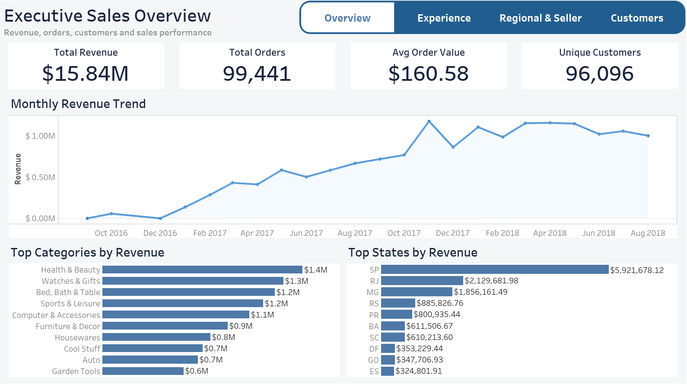
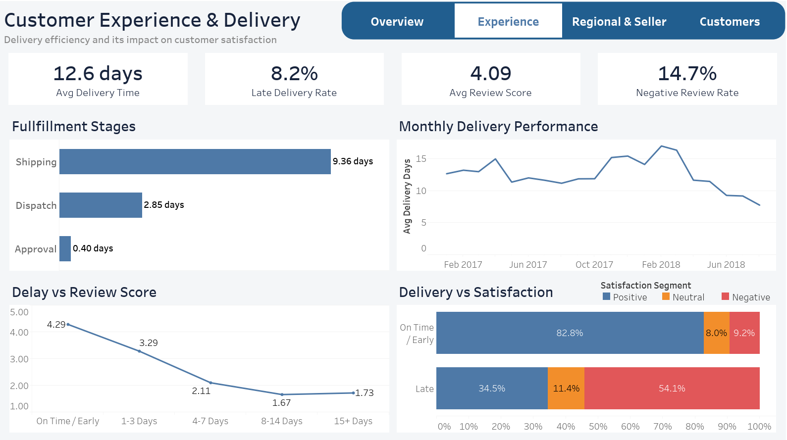
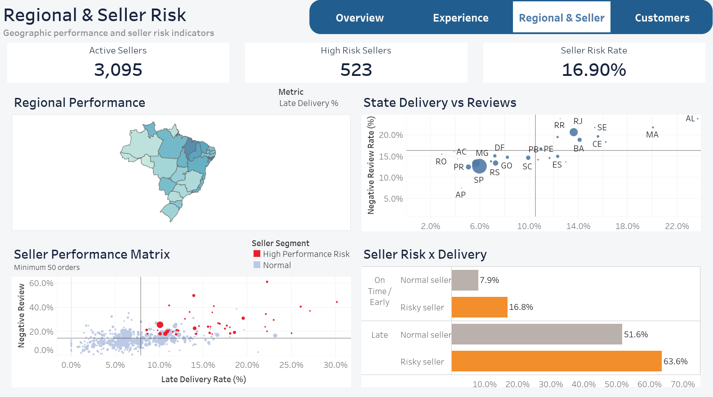
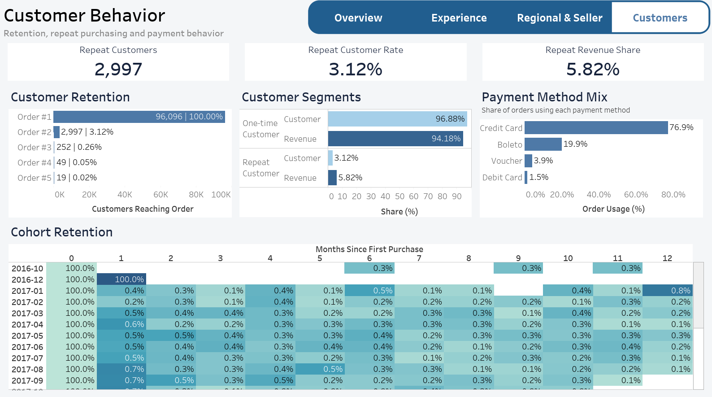

# Olist E-Commerce Analysis | MySQL & Tableau

## 1. Project overview

An end-to-end portfolio project analyzing sales, customer behavior, and operational performance in the Brazilian E-Commerce Public Dataset by Olist. MySQL queries explore the marketplace from order-level transactions through delivery outcomes, customer reviews, and seller performance. Four Tableau dashboards bring the findings together for business review.

The objective is to identify where sales originate, how delivery reliability relates to customer experience, and which customer, regional, and seller patterns warrant further attention.

## 2. Tools and techniques

| Tool | Use |
| --- | --- |
| MySQL 8.0+ | Data imports, validation, joins, CTEs, window functions, aggregations, and analytical views |
| MySQL Workbench | Query execution, result inspection, and data export |
| Tableau | Four dashboards covering commercial performance, customer experience, operational risk, and customer behavior |

## 3. Dataset

**Source:** [Brazilian E-Commerce Public Dataset by Olist](https://www.kaggle.com/datasets/olistbr/brazilian-ecommerce)

The project covers orders placed during **2016–2018**, with **99,441 orders**, **112,650 order items**, and **96,096 distinct customers**. Monetary values are historical **Brazilian reais (BRL / R$)**.

The nine source tables cover orders, customers, order items, payments, reviews, products, sellers, geolocation, and product-category translations. Orders can contain multiple items, payments, sellers, and review records, so identifying the grain of each table is essential before joining them.

Raw CSV files are not included. Download them from the original dataset source.

## 4. Business questions

- How do sales change over time, and which categories and states contribute most?
- How often do customers return, and how does repeat-customer value compare with one-time purchasing?
- Which fulfillment stages account for delivery time, and where are delays most common?
- How do delivery delays relate to review scores and negative feedback?
- Which regions and sellers show performance risks?
- How do payment methods and installment patterns vary across orders?
- What recurring complaint themes appear in review comments?

## 5. Dashboard previews

Explore the [dashboard PDF](dashboards/Olist_Ecommerce_Analysis.pdf) or download the [packaged Tableau workbook](dashboards/Olist_Ecommerce_Analysis.twbx) to open in compatible Tableau software.

### 01 — Executive Sales Overview

Revenue, orders, average order value, and unique customers, supported by monthly revenue trends and category/state comparisons.

### 02 — Customer Experience & Delivery

Fulfillment and delivery performance, customer satisfaction, and the relationship between delay severity and review scores.

### 03 — Regional & Seller Risk

Geographic performance and seller risk indicators to help prioritize operational investigation.

### 04 — Customer Behavior & Insights

Repeat purchasing, customer segments, cohort retention, and payment-method usage.

## 6. Key findings

| Finding | Business interpretation |
| --- | --- |
| Dashboard sales value totals **R$15.84 million**, with **99,441 orders** and **R$160.58 average order value**. | Establishes the marketplace's commercial baseline. Sales value includes freight; AOV covers orders with item value. |
| Only **2,997 customers (3.12%)** placed more than one order during the observation period. | Repeat purchasing is limited within the available history. |
| Repeat customers contribute **5.82% of sales value**, averaging **R$307.66 per customer**, compared with **R$160.28** for one-time customers. | Returning customers account for a greater share of value than their share of customers. |
| Average delivery time is **12.62 days** across **95,082 chronologically valid delivered orders**. | Provides a baseline for monitoring fulfillment and logistics performance. |
| Earlier validated delivery/review comparisons show average scores of approximately **4.29 for on-time/early orders** and **2.57 for late orders**. | Delivery delays are associated with a substantial deterioration in customer satisfaction. Exact results depend on the review and lateness convention used. |
| Credit cards are used on approximately **76.94%** of paid orders, followed by boleto at **19.90%**. | Credit cards dominate payment usage. Orders can use multiple methods, so usage percentages are not mutually exclusive. |

These are historical dashboard findings, not a claim that every figure has been regenerated from the revised scripts. Product-only revenue, comment records and exploratory fixed-threshold risk comparisons remain explicitly distinct; see [metric definitions](docs/metric_definitions.md).

## 7. Recommendations

| Priority | Suggested action | Measures to monitor |
| --- | --- | --- |
| Delivery reliability | Investigate delayed routes and fulfillment stages; prioritize regions with both material order volume and poor delivery performance. | Late-delivery rate, delivery time, approval/dispatch/shipping duration |
| Seller performance | Use seller scorecards to flag sellers for investigation and targeted operational support. | Dispatch time, late-delivery rate, review score, negative-review rate |
| Customer retention | Test post-purchase follow-ups and relevant repeat-purchase campaigns, then evaluate whether they increase return purchasing. | Repeat-customer rate, cohort retention, repeat-customer sales share |
| Product and service quality | Review complaint themes alongside category and seller results to investigate recurring problems. | Negative-review rate, complaint-theme frequency, order volume |

These are proposed actions based on historical patterns; their business impact has not been measured in this project.

## 8. Repository structure

| Path | Contents |
| --- | --- |
| [sql/01.setup/](sql/01.setup/) | Source schema followed by CSV import statements |
| [sql/02.analysis/](sql/02.analysis/) | Eleven scripts covering sales, customers, cohorts, categories, delivery, satisfaction, payments, sellers, regions, review themes, and cross-dimensional insights |
| [sql/03.validation/](sql/03.validation/) | Row-count, relationship, and data-coverage checks |
| [sql/04.views/](sql/04.views/) | Four ordered scripts defining the fourteen Tableau analytical views |
| [docs/metric_definitions.md](docs/metric_definitions.md) | Calculation definitions, population differences, and interpretation caveats |
| [dashboards/](dashboards/) | Four dashboard images, a PDF export, and the packaged Tableau workbook |

## 9. How to reproduce

1. **Download the data** from the linked Olist dataset and extract the CSV files.
2. **Prepare MySQL 8.0+** and run [01_create_schema.sql](sql/01.setup/01_create_schema.sql) in a new database. It creates the nine source tables, including the `review_row_id` surrogate column used by review-ranking queries. Existing tables are not dropped or replaced.
3. **Import the CSVs** using [02_import_data.sql](sql/01.setup/02_import_data.sql). Replace the local Windows paths, check CSV newline settings, and configure `LOCAL INFILE` as needed. Import each source file once and inspect import warnings.
4. **Validate the data** using [01_data_validation.sql](sql/03.validation/01_data_validation.sql). Review counts, missing relationships, and coverage before analyzing results.
5. **Explore the analysis scripts** in `sql/02.analysis/`. These operate on the source tables and can be run independently of the dashboard views.
6. **Create the dashboard views** by running the four files in `sql/04.views/` in numeric order. The seller-performance view must exist before `vw_kpis` is created.
7. **Open the Tableau workbook** to inspect the presentation. To rebuild or refresh it, connect Tableau to the MySQL views or export view results and update the workbook's data sources as required.

The import SQL preserves the original workflow and is not a complete automated installation. A local MySQL setup is required to rerun the SQL; the PDF provides a static view of the dashboards.

## 10. Methodology and limitations

- **Sales definition:** Final dashboard revenue is `SUM(price + freight_value)` across all order statuses. It represents item sales value plus freight, rather than profit or Olist's own platform revenue. Product/category supporting queries explicitly label item-price-only values as product revenue; general sales and customer summaries use all statuses. AOV averages non-null order-level item-plus-freight values, so its denominator differs from the total order count.
- **Customer identity:** Customer-level retention and segmentation use `customer_unique_id`. The category sales view also counts distinct `customer_unique_id` values, so its customer measure represents people across purchases.
- **Join grain:** One-to-many relationships require aggregation or deduplication before combining measures. Orders spanning multiple categories or sellers can appear in multiple groups; group-level distinct counts are not additive.
- **Delivery population:** Final delivery KPIs require complete timestamps in chronological order. The historical import yields 95,082 valid delivered orders. Operational comparisons and impact views use that eligibility rule and full timestamp lateness. The delivery-time distribution alone uses explicitly labelled calendar-day bands. Reviews outside operational comparisons can cover broader populations.
- **Review handling:** KPI, state, review, and seller dashboard views select the latest review answer per order, using descending `review_row_id` as a tie-breaker. Order-level supporting and impact queries now use the same latest-review convention. Original review rows remain only for comment-record exploration. Negative reviews generally mean scores 1–2, neutral 3, and positive 4–5.
- **Risk screening:** Seller-risk segments use comparisons against seller averages. They are investigation heuristics, not validated predictive models or proof of seller responsibility.
- **Retention window:** Repeat purchasing and cohorts describe activity observed in this dataset. Later cohorts have shorter follow-up periods; unobserved future months must not be treated as zero retention. Endpoint months also have limited sales coverage.
- **Payment and text analysis:** Payment-method usage can total more than 100% because orders can use several methods. Review-comment themes use overlapping Portuguese keyword/regex rules and are not validated sentiment analysis.
- **Interpretation:** Findings describe historical associations. They do not establish that delays, sellers, payment choices, or categories caused the observed review outcomes.

See [metric_definitions.md](docs/metric_definitions.md) for revised calculation rules, intentional exploratory differences and refresh requirements.

